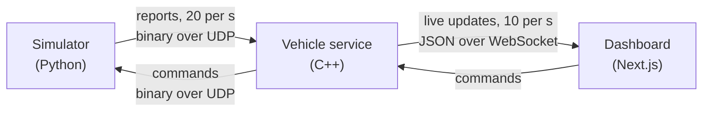

# RooverCommand

A ground station for a simulated robot vehicle. A Python simulator plays the vehicle, a C++ service checks every message and keeps it safe when something goes wrong, and a web dashboard shows it all live.

> Everything here is simulated. The safety logic is a demonstration and is not certified for any real vehicle.


## How it fits together



- **Simulator:** drives a 5-checkpoint mission in Lagos and **steers around obstacles** in its path with 1.5 m to spare, braking by itself so it can never hit one. Drains a 6-cell battery, heats its motor, tilts on hills. Can fake six problems on demand.
- **Vehicle service:** checks size, header, checksum, value ranges and order of every report. Watches for silence, loss, bad data, low battery, heat, weak GPS, obstacles too close and a no-go zone. Runs a safety state machine (Normal, Warning, Safe State, Recovery), stops the vehicle when needed, and never lets it restart by itself.
- **Dashboard:** stat cards, a live 3D rover, a satellite map with the route and no-go zone, charts, controls, mission progress, an event log and fault switches. Works on a phone.

Details: [SPEC.md](SPEC.md) (what it does) and [TECHNICAL.md](TECHNICAL.md) (how it is built).

## Run it

**With Docker** (one command):

```
docker compose up --build
```

Open http://localhost:3000, press **Start**.

**Without Docker**, you need CMake with a C++23 compiler (GCC 14, Clang 18, or Visual Studio 2022+), Python 3.12, and Node 24.

```
# 1. Build the service (on Windows, run this in a Developer PowerShell)
cmake -S services/vehicle -B services/vehicle/build -G Ninja
cmake --build services/vehicle/build

# 2. Install the dashboard
cd apps/dashboard && npm install && cd ../..

# 3. Start all three
node scripts/dev.mjs
```

**On a server (Coolify)**: create a Docker Compose resource from this repo using `docker-compose.yml`. Give `dashboard` a domain on port 3000 and `vehicle-service` one on port 8080, then set `VEHICLE_WS_URL=wss://<vehicle-service domain>`. The simulator needs no domain.

## Try it

1. Press **Start**. The rover drives the mission and checkpoints tick off. Watch it steer around the boulder piles on the route (brown on the map). **Pause** stops it where it is; **Resume** carries on.
2. In **Practice Problems**, turn on **Allow practice problems**, press **Overheating**. Watch the motor pass 70 °C (Warning), then 85 °C (Safety stop). The service stops the vehicle and greys out Start.
3. Press **Fix all problems**. The status goes to Checking, then All good after 5 clean seconds. The vehicle waits for you to press Start.
4. Try **Lose signal**: a safety stop within 1.5 s. Try **Garbled messages** and **Faulty sensors**, then watch the bad messages counted on the Telemetry page.
5. Pick **Manual** and drive with the arrow keys, or the on-screen arrows on a phone. Try driving straight at a boulder: it brakes by itself.

New to all this? Tap any **?** for a plain explanation of that card.

## Tests

| Suite | Tests | Command |
| --- | --- | --- |
| C++ unit (GoogleTest) | 62 | `ctest --test-dir services/vehicle/build` |
| Simulator (pytest) | 26 | `pytest simulator/tests` |
| Integration: real service, fake vehicle and dashboard (pytest) | 7 | `pytest tests` |
| Browser: all three programs (Playwright) | 3 | `cd apps/dashboard && npm run build && npm run test:e2e` |

All pass. CI runs them on every push, with memory and undefined-behavior checks on Linux, plus a Windows build.

The C++ tests never sleep: logic takes the time as an argument, so a 5-second recovery test runs in microseconds.

## Layout

```
apps/dashboard/      Next.js dashboard
services/vehicle/    C++ service and its tests
simulator/           Python vehicle and its tests
protocol/            message layout, mission, shared sample bytes
tests/               integration tests
scripts/dev.mjs      start everything without Docker
```

## Built with

C++23, CMake, IXWebSocket, nlohmann/json, GoogleTest. Python 3.12, pytest. Next.js 16, TypeScript, Tailwind CSS, Recharts, MapLibre, react-three-fiber, Playwright. Docker Compose, GitHub Actions.
